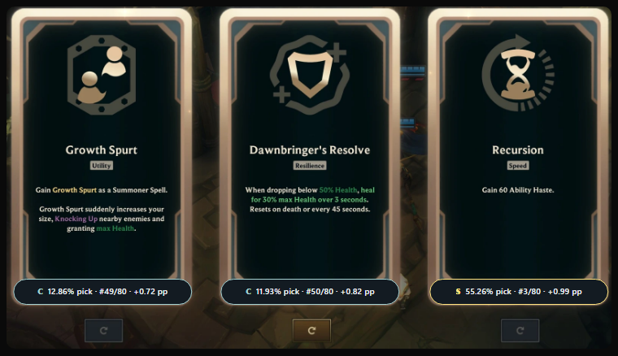
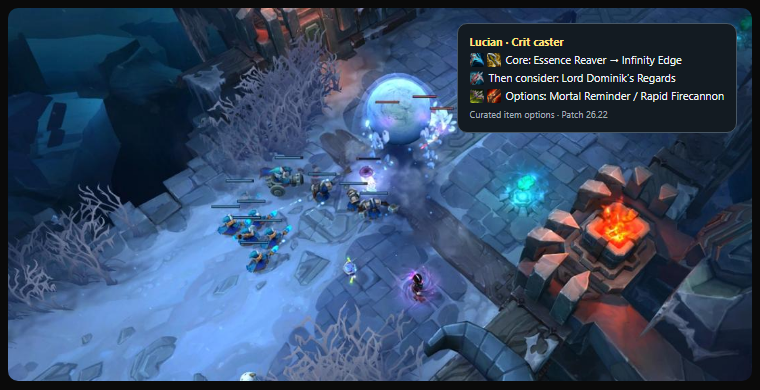

# Minimal Mayhem Overlay

A native Rust overlay for ARAM Mayhem on Windows. Press **F8** while an augment
offer is visible to read its three title regions once and display each card's
**S–D tier**, **overall pick rate**, **pick-rate rank within its rarity**, and
the change since the previous published patch in percentage points (pp).
Press **Ctrl+Shift+F8** to quit. The rounded badges sit near the bottom of each
card, above the reroll controls. They are click-through and hide after six
seconds or when League loses focus. Press F8 again after a reroll.

## Previews

**F8 · Augment stats**



**Alt+F8 · Champion build**



These are simulated placements on game screenshots. [Augment screenshot from Hexgate](https://hexgate.app/blog/riot-third-party-apps/) · [Howling Abyss screenshot from Riot Games](https://www.leagueoflegends.com/en-gb/news/dev/dev-bringing-mayhem-to-aram/)

## Run

The current version builds from source on Windows with Rust and the Windows
build tools. The app uses Windows' English OCR capability.

1. Clone the repository and run `cargo build --release --locked`.
2. Launch `target/release/minimal-mayhem-overlay.exe`.
3. Set League's window mode to **Borderless** and its text language to **English**.
4. Open an ARAM Mayhem augment offer and press F8. A **?** means a card title
   could not be matched confidently.

The console lists the scan shortcuts Windows registered, including a backup
when one is available. It also reports when a scan starts and how many titles it read.

The overlay detects your champion from League's local Live Client Data API
when you request a build or scan a readable offer. To override detection,
launch with `--champion Lucian` using the Riot champion key (for example,
`MasterYi`).
Hints come from the provider's current editorial combo catalog. Historical
refreshes use the current catalog filtered to augments active in that patch.
Press **Shift+F8** for the data patch, stats date, and movement in the
provider's global pick-rate ranking since its previous snapshot.

### Normal item builds

Press **Alt+F8** while League is in the foreground to see three core items
and two alternatives for your champion. The view works
without an augment offer or a champion stats file. Routes are curated by
archetype, with champion overrides where applicable. Champion names and
default classes come from [Riot Data Dragon](https://developer.riotgames.com/docs/lol#data-dragon).
The build panel and Weapon of Destiny pairings use bundled Data Dragon icons.
Press **Ctrl+F8** to disable or re-enable the build view and item pairing chips.

### Optional champion match stats

```powershell
pwsh -NoProfile -File scripts/update-champion-picks.ps1 -Champion Lucian
.\target\release\minimal-mayhem-overlay.exe
```

The script writes a small `champion-picks.json` file beside the executable.
The overlay reads it on demand and uses it when the champion and patch match.
The percentage is the share of sampled Chinese-server games with that champion
in which the augment was recorded. The pick count is the numerator. The source
tracks completed matches, so this share differs from picks divided by offers.
Unmatched augment names are omitted.

When F8 recognizes **Weapon of Destiny**, the overlay can show up to two
legendary items most often recorded first for the champion in AramHex's
published sample. Record order comes from completed games. Press **Ctrl+F8**
to toggle item pairings. They start enabled on every launch. Regenerate an
older `champion-picks.json` to add the item records.

[Champion data: AramHex](https://github.com/czgreat/aramhex-data)
([CC BY-NC 4.0](https://creativecommons.org/licenses/by-nc/4.0/)).
The generated file contains matched counts and excludes wins and win rates.

The prototype assumes the default offer layout. It uses Windows' built-in en-US
OCR. Run `minimal-mayhem-overlay.exe --check-ocr` to check that the OCR language is
available. Screen crops are processed in memory. The app waits for Windows
messages while idle. Champion detection reads League's loopback endpoint on
demand. The overlay makes no internet requests. It captures the title regions
with Win32 GDI, calls Windows OCR through the Rust `windows` crate, and matches
the recognized text to augment names with `strsim`.

## How tiers are calculated

The bundled [patch snapshot](data/augments.json) groups augments by rarity and splits each
group into five bands by overall pick-rate rank. These badges measure pick
popularity across champions. They use a separate grading formula from OP.GG.

[Data: arammayhem.com](https://arammayhem.com/data/) ([CC BY 4.0](https://creativecommons.org/licenses/by/4.0/)).
The bundled snapshot retains the English name, rarity, and pick rate from each
active augment row with a published pick rate.

## Refresh patch data

Once arammayhem.com publishes the new patch export, run these commands from the
repository root using PowerShell 7 and Rust:

```powershell
pwsh -NoProfile -File scripts/update-augments.ps1
pwsh -NoProfile -File scripts/update-item-icons.ps1
cargo build --release --locked
```

Pass `-Patch 26.22` to select a specific patch and confirm the reported patch
and stats date before sharing the rebuilt executable. The script replaces the
bundled snapshot only after validating the export. The app embeds the snapshot
at build time and grades it offline.

Initial title band and card spacing informed by [Hexsight's OCR implementation](https://github.com/bard58/hexsight/blob/v0.1.2/src/ocr.rs).

## Report an issue

When reporting an OCR or placement issue, include the game resolution, display
scaling, League patch, and whether the game was in Borderless mode. Run
`minimal-mayhem-overlay.exe --check-ocr` to check the OCR engine. For code
changes, run `cargo fmt --check` and `cargo test --locked` on Windows.
[GitHub issues](https://github.com/andrewnash/minimal-mayhem-overlay/issues)

## License

The code is licensed under [Beerware, Revision 42](LICENSE). The bundled
augment data is licensed separately under CC BY 4.0, as credited above.

Minimal Mayhem Overlay is not endorsed by Riot Games and does not reflect
the views or opinions of Riot Games or anyone officially involved in
producing or managing Riot Games properties. Riot Games and all associated
properties are trademarks or registered trademarks of Riot Games, Inc.
